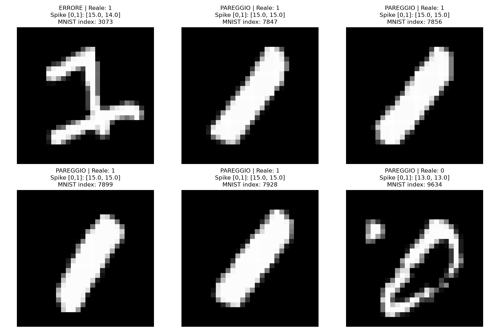
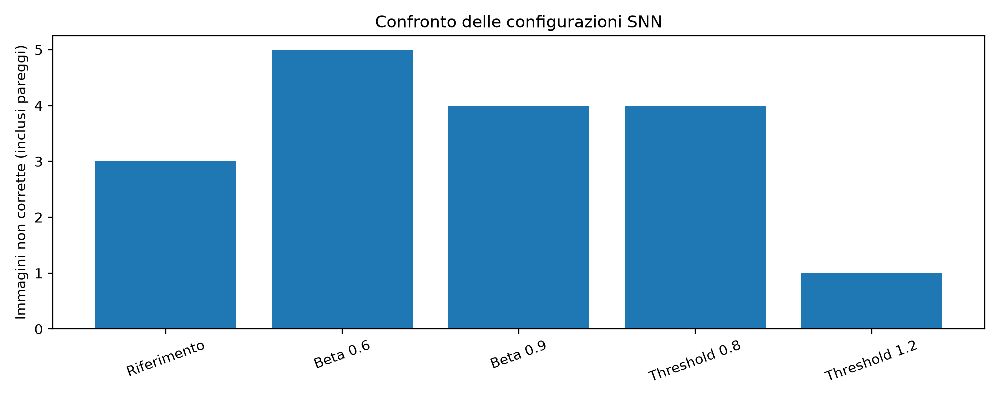
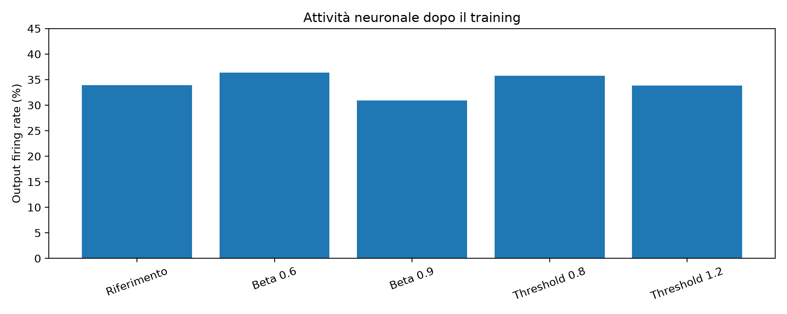
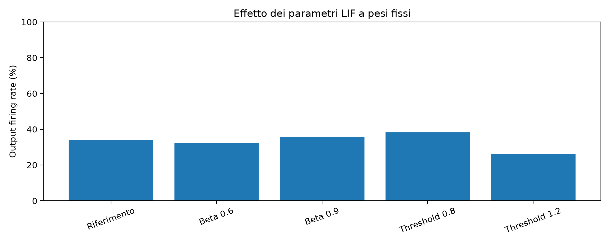
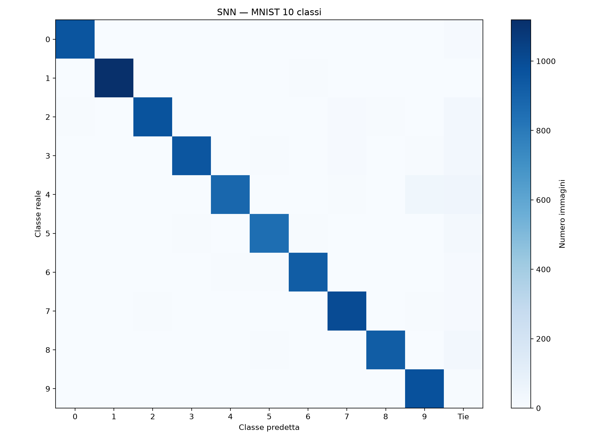

# LIF to SNN — Computational Neuroscience

**From a manually implemented Leaky Integrate-and-Fire neuron to a trainable Spiking Neural Network for binary MNIST classification.**

This educational project explores how neurons integrate input signals, generate discrete spikes, and learn to classify patterns through trainable synaptic connections.

The project was developed incrementally using Python, NumPy, PyTorch, snnTorch and Matplotlib.

**Status: November 2026 — implementation and experiments completed; documentation and repository finalization in progress.**

## 1. Project goals

The central question is:

**How does a Leaky Integrate-and-Fire (LIF) neuron transform input signals into spikes, and how can a network of such neurons learn to classify patterns?**

The project follows six stages:

1. Implement the LIF model from its discrete-time equation.
2. Analyze spike trains, firing rates and inter-spike intervals.
3. Build a small feedforward SNN using snnTorch.
4. Understand training through surrogate gradients and backpropagation through time.
5. Train and evaluate an SNN for binary MNIST classification.
6. Investigate how neuronal parameters influence network activity and classification.

The objective is to develop a reproducible and explainable computational neuroscience project, rather than claim an original research contribution.

## 2. Repository structure

```text
lif-to-snn/
├── 01_lif_neuron.py
├── 03_simple_snn.py
├── 04_training_basics.py
├── 05_snn_training.py
├── 06_binary_classification.py
├── 07_mnist_exploration.py
├── 08_mnist_spike_encoding.py
├── 09_mnist_snn_training.py
├── 10_mnist_parameter_study.py
├── 11_mnist_fixed_weights.py
├── mnist_snn_model.py
├── figures/
├── results/
├── checkpoints/
├── data/
├── requirements.txt
├── .gitignore
├── AGENTS.md
└── README.md
```

The first script also contains the initial spike-train analysis, so no separate `02_spike_trains.py` is required.

The `data/` directory contains the downloaded MNIST dataset. The `checkpoints/` directory stores trained model weights. Both can be excluded from Git because they are generated locally.

## 3. Environment and installation

The project was developed on macOS using Python and a virtual environment.

Main dependencies:

- Python 3
- NumPy
- PyTorch
- torchvision
- snnTorch
- Matplotlib

Create the environment and install the dependencies from the repository root:

```bash
python3 -m venv .venv
./.venv/bin/python -m pip install -r requirements.txt
```

The `requirements.txt` file should reflect the versions used in the working environment.

MNIST is downloaded automatically by torchvision when the corresponding scripts are executed.

## 4. Part I — The Leaky Integrate-and-Fire neuron

### 4.1 Mathematical model

The LIF neuron is a simplified model of neuronal membrane dynamics.

A continuous-time formulation inspired by an RC circuit is:

\[
\tau_m \frac{dU}{dt}=-U+RI
\]

where:

- \(U\) is the membrane potential.
- \(\tau_m\) is the membrane time constant.
- \(R\) is the membrane resistance.
- \(I\) is the applied current.

Using an explicit Euler discretization and a rescaled input, the implemented model is:

\[
U_{k+1}=\beta U_k+J_k
\]

with:

\[
\beta=1-\frac{\Delta t}{\tau_m}
\]

The parameter \(\beta\) determines how much of the previous membrane potential is retained between simulation steps.

When the potential reaches the threshold, the neuron emits a spike and its membrane potential is reset to zero.

The manual implementation records both pre-reset and post-reset membrane potentials.

No physical time interval is assigned to an individual simulation step; firing rates are therefore reported per simulation step rather than in hertz.

### 4.2 Response to constant input

The neuron was simulated for 100 steps with:

- \(\beta=0.8\)
- Threshold = 1
- Zero reset

| Input current \(J\) | Number of spikes | Spike rate | Mean ISI (steps) |
|---:|---:|---:|---:|
| 0.15 | 0 | 0.00 | Undefined |
| 0.25 | 12 | 0.12 | 8 |
| 0.40 | 25 | 0.25 | 4 |
| 0.60 | 50 | 0.50 | 2 |

For a constant input and \(0<\beta<1\), the membrane potential without reset approaches:

\[
U_{\infty}=\frac{J}{1-\beta}
\]

For \(J=0.15\), the limiting potential is 0.75, below the threshold. Consequently, no spikes are generated from an initially zero state.

### 4.3 Spike trains and inter-spike intervals

A spike train represents neuronal output as a sequence of binary events.

The mean spike rate over a simulation of \(T\) steps is:

\[
r=\frac{N_{\mathrm{spikes}}}{T}
\]

The inter-spike interval (ISI) is the distance between consecutive spike events.

These quantities were implemented and visualized in `01_lif_neuron.py`.

## 5. Part II — Building a small SNN

### 5.1 First feedforward network

The initial network, implemented in `03_simple_snn.py`, contains two input LIF neurons connected to one output LIF neuron.

```text
Two input currents
       |
       v
  2 LIF neurons
       |
       v
   Linear(2, 1)
       |
       v
   1 output LIF
```

Each simulation step applies synaptic weights to the input spikes, computes the output current and updates the output neuron's membrane potential.

For fixed input currents `[0.25, 0.60]`, synaptic weights `[0.6, 0.6]` and 30 simulation steps:

| Neuron | Spike count |
|---|---:|
| Input LIF 1 | 3 |
| Input LIF 2 | 15 |
| Output LIF | 7 |

A subsequent experiment changed only the second synaptic weight from 0.99 to 1.01. The input spike trains remained unchanged, while the output spike count increased from 7 to 15.

This illustrates how small changes in synaptic strength can produce discontinuous changes in spiking behavior.

### 5.2 Introduction to training

`04_training_basics.py` introduces automatic differentiation, loss functions, gradient descent and parameter updates using a simple PyTorch linear layer.

`05_snn_training.py` extends these concepts to a spiking network, using surrogate gradients and backpropagation through time (BPTT).

An initial experiment attempted to train the output neuron toward a firing rate of 0.30 over 30 simulation steps.

The observed response alternated between rates of approximately 0.233 and 0.500 for the tested weight configurations.

This experiment demonstrated that surrogate-gradient optimization does not guarantee smooth or monotonic changes in discrete spike counts.

## 6. Part III — Supervised classification

### 6.1 Synthetic binary classification

Before using MNIST, a small SNN was trained to distinguish two synthetic input patterns:

- `[0.60, 0.25]` → class 0
- `[0.25, 0.60]` → class 1

The network contained two input LIF neurons, a linear connection and two output LIF neurons.

Classification was based on the number of spikes emitted by each output neuron.

The model correctly classified both training patterns and four nearby test patterns. However, additional stress tests revealed limitations: some different input currents generated identical spike trains, making the corresponding patterns indistinguishable to this architecture.

These results motivated the transition to real image data and probabilistic spike encoding.

### 6.2 MNIST exploration and rate coding

`07_mnist_exploration.py` loads and visualizes MNIST images.

Each image is a grayscale tensor of shape:

`[1, 28, 28]`

Pixel intensities are normalized between 0 and 1.

`08_mnist_spike_encoding.py` converts pixel intensities into binary spikes using probabilistic rate coding.

For 30 simulation steps, a single image becomes:

`[30, 1, 28, 28]`

Flattening the spatial dimensions produces:

`[30, 784]`

For a batch of 32 images, the corresponding input shape becomes:

`[30, 32, 784]`

Each pixel's normalized intensity determines its probability of generating a spike at a given simulation step.

## 7. Part IV — Binary MNIST classifier

### 7.1 Network architecture

The final network is a fully connected SNN:

```text
MNIST image (28 × 28)
          |
          v
Probabilistic rate coding
          |
          v
784 input spike streams
          |
          v
Linear(784, 32)
          |
          v
32 hidden LIF neurons
          |
          v
Linear(32, 2)
          |
          v
2 output LIF neurons
          |
          v
Output spike counts
          |
          v
Prediction: 0 or 1
```

The network contains **25,152 learnable synaptic weights**.

The input spike streams are not themselves modeled as trainable LIF neurons.

Default configuration:

| Parameter | Value |
|---|---:|
| Hidden LIF neurons | 32 |
| Output LIF neurons | 2 |
| Beta | 0.8 |
| Threshold | 1.0 |
| Simulation steps | 30 |
| Batch size | 32 |
| Training epochs | 3 |
| Optimizer | Adam |
| Learning rate | 0.001 |
| Loss | Cross-entropy on output spike counts |

Training uses surrogate gradients to propagate gradients through the LIF spike-generation process, together with BPTT through the simulated time steps.

### 7.2 Dataset

Only MNIST digits 0 and 1 were used.

| Dataset | Zeros | Ones | Total |
|---|---:|---:|---:|
| Training | 5,923 | 6,742 | 12,665 |
| Test | 980 | 1,135 | 2,115 |

The model was trained using the original MNIST training partition and evaluated on the separate official test partition.

### 7.3 Training results

| Epoch | Training loss | Training accuracy | Ties |
|---|---:|---:|---:|
| 1 | 0.0254 | 98.11% | 1.69% |
| 2 | 0.0049 | 99.73% | 0.14% |
| 3 | 0.0018 | 99.91% | 0.05% |

Training accuracy was aggregated while the weights were being updated across batches. It is not an independent evaluation of the final model.

### 7.4 Test results

The trained model was evaluated five times with different probabilistic input spike realizations.

| Test | Accuracy | Ties | Classification errors |
|---|---:|---:|---:|
| 1 | 99.72% | 0.24% | 1 |
| 2 | 99.72% | 0.24% | 1 |
| 3 | 99.72% | 0.24% | 1 |
| 4 | 99.76% | 0.19% | 1 |
| 5 | 99.81% | 0.14% | 1 |

Ties were treated as unsuccessful classifications rather than being assigned automatically to class 0.

The first test produced the following confusion matrix:

| Actual class | Predicted 0 | Predicted 1 | Tie |
|---|---:|---:|---:|
| 0 | 979 | 0 | 1 |
| 1 | 1 | 1,130 | 4 |

Thus, 2,109 out of 2,115 images were correctly classified.

The results indicate strong performance on this binary task. They do not establish comparable performance on all ten MNIST classes.

## 8. Analysis of classification failures

Six problematic images were identified in the first complete test.

| MNIST test index | Actual class | Output spikes [0, 1] | Result |
|---:|---:|---|---|
| 3073 | 1 | [15, 14] | Incorrect |
| 7847 | 1 | [15, 15] | Tie |
| 7856 | 1 | [15, 15] | Tie |
| 7899 | 1 | [15, 15] | Tie |
| 7928 | 1 | [15, 15] | Tie |
| 9634 | 0 | [13, 13] | Tie |

The output neurons were not silent in these cases. Instead, their spike counts were nearly identical.

The main observed failure mode was therefore **insufficient separation between output spike counts**.

Visual inspection revealed unusual handwriting characteristics, but their causal role was not established.



## 9. Part V — Influence of LIF parameters

Two complementary experiments investigated the effects of the membrane decay parameter β and the spike threshold.

Both used a separate training-validation split taken exclusively from the original MNIST training partition:

- Training: 11,399 images.
- Validation: 1,266 images.

The official test partition was not used to select the experimental parameter configurations.

### 9.1 Experiment A — Independently retrained networks

Five networks were trained independently, changing one parameter at a time.

All other training settings were kept constant.

| Configuration | Validation accuracy | Output firing rate |
|---|---:|---:|
| β = 0.8, θ = 1.0 | 99.76% | 33.94% |
| β = 0.6, θ = 1.0 | 99.61% | 36.40% |
| β = 0.9, θ = 1.0 | 99.68% | 30.95% |
| β = 0.8, θ = 0.8 | 99.68% | 35.78% |
| β = 0.8, θ = 1.2 | 99.92% | 33.87% |

The output firing rate is the average fraction of simulation steps in which an output neuron generated a spike, averaged over both output neurons and the validation images.

All configurations achieved high classification accuracy, but different output firing rates.

Because the networks were independently retrained, these results reflect both the neuronal parameters and the learned synaptic weights.





### 9.2 Experiment B — Fixed synaptic weights

A separate reference network was trained only on the training portion of the training-validation split.

Its synaptic weights were copied into other networks. Beta and threshold were then modified without additional training.

| Configuration | Validation accuracy | Output firing rate |
|---|---:|---:|
| β = 0.8, θ = 1.0 | 99.76% | 33.94% |
| β = 0.6, θ = 1.0 | 98.97% | 32.42% |
| β = 0.9, θ = 1.0 | 99.76% | 35.94% |
| β = 0.8, θ = 0.8 | 99.76% | 38.19% |
| β = 0.8, θ = 1.2 | 99.68% | 26.18% |

With fixed synaptic weights, a higher beta increased the observed output firing rate, whereas a higher threshold reduced it.



### 9.3 Main observation

The experiments distinguish two effects:

**Fixed weights:** changing neuronal parameters modifies the network dynamics without allowing the synaptic weights to adapt.

**Independent retraining:** the network can learn new weights that compensate for, or reverse, the firing-rate trends observed at fixed weights.

This is the main conceptual outcome of the parameter study.

The parameters were changed in both LIF layers simultaneously; the experiments do not isolate the contribution of individual layers.

Small accuracy differences should also be interpreted cautiously because the parameter comparisons used only one initialization seed per configuration.

## 10. Reproducibility

### Main training and evaluation

Run:

```bash
./.venv/bin/python 09_mnist_snn_training.py
```

Set `TRAIN_MODEL = True` to train the baseline model and save its weights.

Set `TRAIN_MODEL = False` to load the saved checkpoint and run evaluation without retraining.

Baseline checkpoint:

`checkpoints/mnist_snn_01.pth`

### Parameter experiments

The shared SNN architecture is defined in:

`mnist_snn_model.py`

Run the two parameter experiments using:

```bash
./.venv/bin/python 10_mnist_parameter_study.py
./.venv/bin/python 11_mnist_fixed_weights.py
```

Script 10 retrains each parameter configuration independently.

Script 11 trains or loads a separate validation reference model and evaluates other parameter settings with the same synaptic weights.

The fixed-weight experiment uses:

`checkpoints/mnist_val_reference.pth`

The experimental scripts save figures to `figures/`. The fixed-weight experiment also saves tabular results to `results/fixed_weights.csv`.

These scripts should be executed from the repository root.

## 11. Limitations

This project is educational and exploratory.

Its main limitations are:

- Classification is restricted to MNIST digits 0 and 1.
- Input spikes are generated probabilistically.
- Parameter comparisons use a limited number of values and one training seed per configuration.
- Beta and threshold are changed in both LIF layers.
- Output firing rate is not an estimate of actual hardware energy consumption.
- The original test partition was examined during development, so its results should not be treated as a completely untouched final benchmark.
- No claim of biological fidelity or original research is made.

Possible future extensions include ten-class MNIST classification, alternative temporal encoding methods, repeated training seeds, more complex SNN architectures and neuromorphic implementations.

## 12. References

- [Python documentation](https://docs.python.org/3/)
- [PyTorch documentation](https://docs.pytorch.org/docs/stable/index.html)
- [PyTorch — Linear layers](https://docs.pytorch.org/docs/stable/generated/torch.nn.Linear.html)
- [snnTorch documentation](https://snntorch.readthedocs.io/)
- [snnTorch — Training Spiking Neural Networks](https://snntorch.readthedocs.io/en/latest/tutorials/tutorial_5.html)

---

**Conclusion:** This project demonstrates how a simple LIF neuron can be extended into a trainable spiking network. It also illustrates why neuronal dynamics and synaptic learning must be considered together when interpreting the behavior of SNNs.

## Extension — Full MNIST Classification (10 Classes)

After completing the binary classification task, the SNN was extended to recognize all ten handwritten digits from the MNIST dataset.

### Architecture

The original fully connected LIF architecture was retained, with a larger hidden layer and ten output neurons:

**784 input spike streams → 128 hidden LIF neurons → 10 output LIF neurons**

The model contains 101,632 trainable synaptic weights.

Training configuration:

| Parameter | Value |
|---|---:|
| Training images | 60,000 |
| Test images | 10,000 |
| Simulation steps | 30 |
| Hidden neurons | 128 |
| Output neurons | 10 |
| Beta | 0.8 |
| Threshold | 1.0 |
| Batch size | 64 |
| Epochs | 3 |
| Optimizer | Adam |
| Learning rate | 0.001 |

The model uses probabilistic rate coding, surrogate gradients and cross-entropy loss on output spike counts.

### Results

| Epoch | Training loss | Training accuracy |
|---|---:|---:|
| 1 | 0.2816 | 89.84% |
| 2 | 0.1316 | 94.88% |
| 3 | 0.0961 | 96.19% |

Performance on the official 10,000-image test partition:

| Metric | Result |
|---|---:|
| Test accuracy | **95.59%** |
| Correct classifications | 9,559 |
| Incorrect classifications | 245 |
| Ties | 196 (1.96%) |
| Mean output firing rate | 16.32% |

Ties between output neurons with the highest spike counts were treated as unsuccessful classifications.

### Error analysis

The most difficult class was digit **4**, with 879 correct predictions out of 982 examples.

The most frequent specific misclassification involved digit 4 being predicted as digit 9 (42 cases). There were also 46 ties among images of digit 4.

These observations identify potential areas for further investigation, but do not establish the visual causes of the errors.



### Conclusion

The same basic SNN design successfully scales from binary digit classification to the complete ten-class MNIST problem.

The resulting accuracy is lower than in the binary experiment, but the classification tasks are not directly equivalent.

The extension demonstrates the flexibility of the original architecture without introducing convolutional layers or additional training mechanisms.

**Implementation:** `12_mnist_10_classes.py`

The extension is complete and forms the final experiment of this repository.